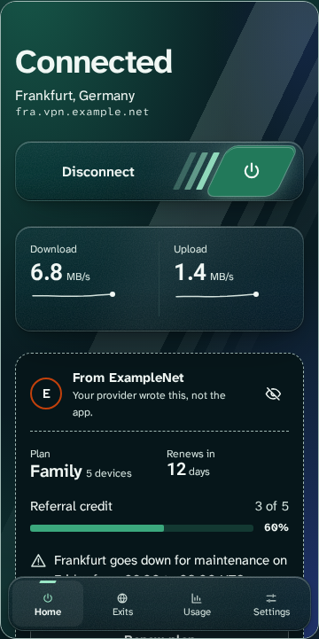
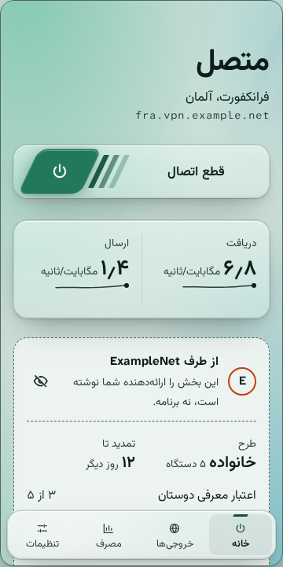
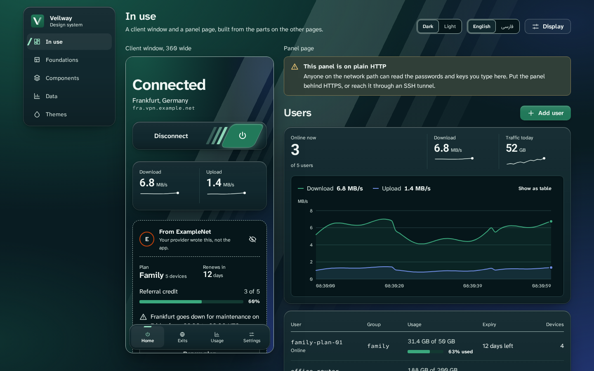
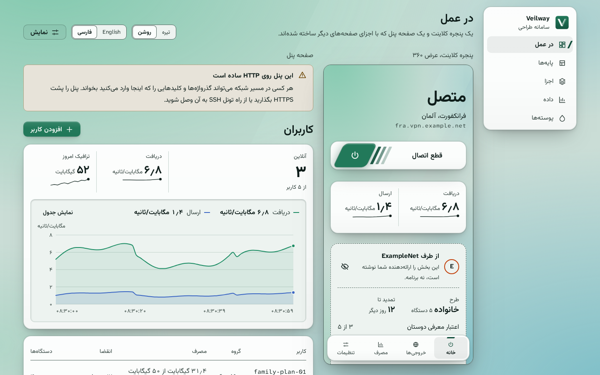

<p align="center">

</p>

<h1 align="center">Veilway UI</h1>

<p align="center">
The design system and the translations shared by the Veilway panel and apps.
</p>

<p align="center">
<b>English</b> | <a href="README.fa.md">فارسی</a>
</p>

<p align="center">
<a href="LICENSE"></a>
<a href="https://t.me/VeilwayGroup"></a>
</p>

## What it is

Veilway is an open-source VPN platform for people on censored networks: a Rust core, a web panel and first-party apps. This repository holds what the panel and the apps share on screen, so they look and behave like one product.

- Design tokens as CSS variables, generated from one token file, with contrast rules that the tests check on every color a ground can take.
- The glass material: four layers (sheet, chrome, popover, dialog), each with a known backdrop behind it, and solid surfaces in their place when the system asks for reduced transparency or the browser has no `backdrop-filter`.
- React components and charts built on them.
- The theme validator. A theme file is color tokens only and is treated as hostile input: a tint too thin for its own backdrop is raised, and a backdrop too bright for text is refused.
- A gallery app that shows every part in dark and light, English and Persian.
- English and Persian, with right-to-left layout, ICU plurals, Persian digits and Jalali dates.

<table>
<tr>
<td></td>
<td></td>
</tr>
<tr>
<td colspan="2"></td>
</tr>
<tr>
<td colspan="2"></td>
</tr>
</table>

<p align="center"><sub>Screenshots of the gallery: a client window in dark English and light Persian, and the page that puts a client window next to a panel page, with solid surfaces in place of the glass. Every name, address and number in them is made up (example.net).</sub></p>

## What it holds

| Path | Package | What it is |
|---|---|---|
| `packages/ui` | `@veilway/ui` | Tokens, the glass material, components, charts, the theme validator and its JSON schema, and the gallery. Its [README](packages/ui/README.md) explains the glass and its contrast rule. |
| `packages/i18n` | `@veilway/i18n` | English and Persian locale packs and helpers for direction, plurals, Persian digits and Jalali dates. No React. |

## Checks and the gallery

Everything runs in containers, with named volumes for `node_modules`. From the repository root:

```
V="-v $PWD/packages:/work/packages -v veilway-i18n-nm:/work/packages/i18n/node_modules -v veilway-ui-nm:/work/packages/ui/node_modules"
docker run --rm $V -w /work/packages/i18n node:22 sh -c "npm ci && npm run check && npm test"
docker run --rm $V -w /work/packages/ui node:22 sh -c "npm ci && npm run check && npm test && npm run build"
docker run --rm $V -w /work/packages/ui -p 127.0.0.1:5173:5173 node:22 npm run dev
```

The last command serves the gallery at `http://127.0.0.1:5173`. The screenshot command, which needs a Playwright image, is in [packages/ui/README.md](packages/ui/README.md).

## Design rules

[CONTRIBUTING.md](CONTRIBUTING.md) has the full list. The ones a change is most likely to break:

- A visible change comes with screenshots in dark and light, English and Persian.
- A theme file and a locale pack are hostile input. A change to the theme validator or the locale loader comes with tests that feed it bad files.
- No pill shapes, no uppercase labels above headings, no emoji, small consistent corner radii.
- Apps never show a rating word for a connection: only its name, and a plain warning when it is not secure.
- No blank lines inside function bodies, double quotes, one-liners where they fit, and never a code formatter.

## Status

> **Early.** The look is approved and the checks pass. The panel and both apps, desktop and Android, use it. How much the glass blur costs in an Android WebView is not measured yet.

## Repositories

- [veilway](https://github.com/veilway-project/veilway): the core, the control API and its TypeScript client, and the desktop and Android apps.
- [veilway-docs](https://github.com/veilway-project/veilway-docs): protocol spec, config reference and manuals, in English and Persian. The site is at [veilway-project.github.io/veilway-docs](https://veilway-project.github.io/veilway-docs/).
- veilway-ui: this repository.

## Contributing and security

Questions and help with setup go to [GitHub Discussions](https://github.com/veilway-project/veilway/discussions), in English or Persian. Issues are for bugs and concrete feature requests.

Read [CONTRIBUTING.md](CONTRIBUTING.md) first. A first pull request asks you to sign the [CLA](CLA.md) once. Report vulnerabilities privately as described in [SECURITY.md](SECURITY.md), never in a public issue.

## License

Apache-2.0, see [LICENSE](LICENSE) and [NOTICE](NOTICE). The license does not cover the name: see [TRADEMARKS.md](TRADEMARKS.md).
